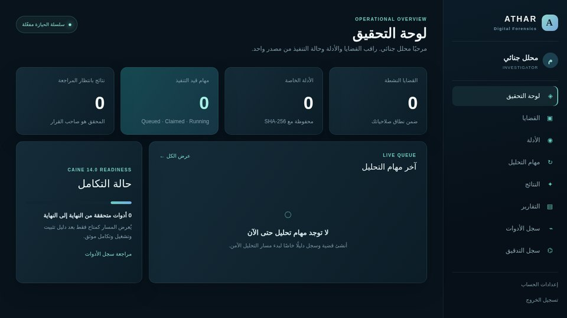
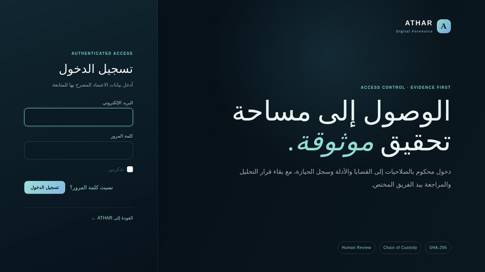
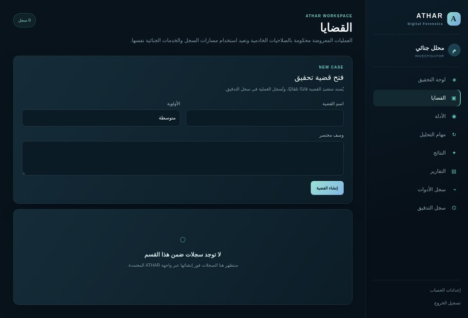
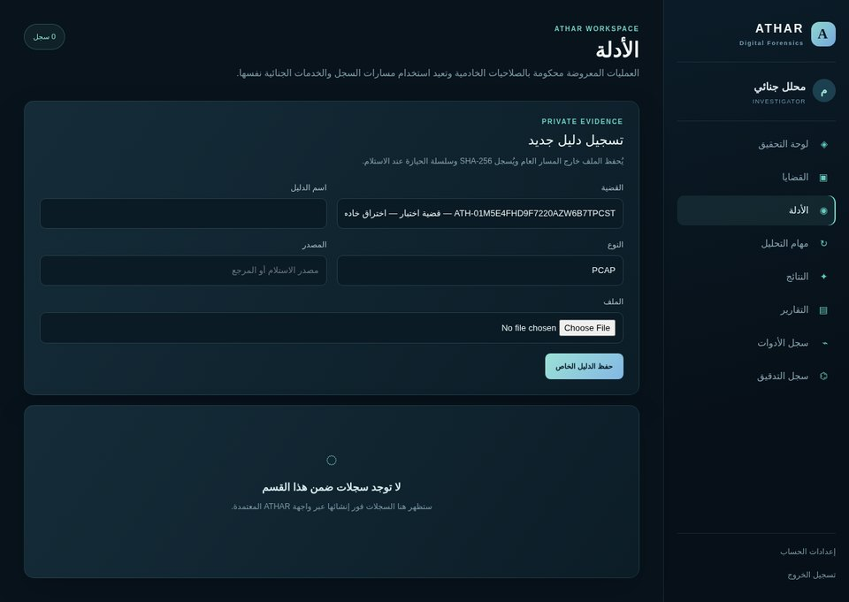

# ATHAR

**ATHAR** is a secure, traceable platform for managing digital-forensics investigations. It is built with **Laravel 13**, **PHP 8.3+**, **MySQL 8**, and **Redis**, while forensic execution is delegated to a separate **Forensic Agent** inside **CAINE 14.0** on VirtualBox.

> ATHAR manages cases, evidence integrity, allowed analysis jobs, results, findings, review, and reports. It is not a replacement for forensic tools and does not automatically reach legal or investigative conclusions.



## First verified path

The first end-to-end integration is intentionally bounded to a benign PCAP sample and TShark:

```text
Case → Evidence → SHA-256 → Analysis Job → Queue → CAINE Agent
→ TShark → Raw Result → Parsed JSON → Finding → Reviewable Report
```

Only an allowlisted `tool_id` and `operation_key` can reach the Agent. ATHAR never sends a raw user-provided shell command, and original evidence is stored privately and accessed read-only during analysis.

## What is implemented

| Area | Status |
|---|---|
| Case management with membership roles (`lead`, `member`, observer) | ✅ |
| Private evidence storage + SHA-256 and per-evidence hash ledger | ✅ |
| Chain-of-custody ledger (hash-chained events) and audit log | ✅ |
| Analysis job state machine (queued → claimed → running → completed/failed, cancel, retry, expiry) | ✅ |
| Agent token authentication (`agent.token` middleware, hashed per-agent tokens) | ✅ |
| Tool Registry with categories, operations, versions, verification states | ✅ |
| Findings and report review workflow | ✅ |
| Arabic-first operator UI (7 workspace sections) | ✅ |
| REST API (34 routes) for cases, evidence, jobs, findings, reports | ✅ |
| CAINE 14.0 Python agent (`tshark.packet_summary` allowlist) | ✅ |
| MySQL 8 / Redis production profile | ⚙️ configuration ready, documented in `docs/LOCAL_SETUP.md` |

## Screenshots

| Login | Cases |
|---|---|
|  |  |



## Repository structure

| Path | Responsibility |
|---|---|
| `app/Domain/Forensics/Services/` | Evidence, hashing, custody, audit, job state machine, tool verification, reports. |
| `app/Http/Controllers/` | Web workspace controllers and the REST API. |
| `config/forensics.php` | Tool Registry policy, evidence disk, and upload limits. |
| `database/migrations/` | Schema for users, cache/jobs, and the ATHAR forensics tables. |
| `docs/` | Architecture, API contract, CAINE Agent, and local setup documentation. |
| `agent/` | Separate Python package installed in CAINE 14.0. |
| `lang/ar/` | Arabic translations for authentication, validation, and UI strings. |
| `tests/Feature/Forensics/` | Laravel feature and security-flow tests. |

## Local setup

See [Local Development Setup](docs/LOCAL_SETUP.md). In short:

```bash
composer install
npm ci && npm run build       # required: the UI fails without Vite assets
cp .env.example .env
php artisan key:generate
touch database/database.sqlite
php artisan migrate --seed
php artisan serve
```

The host system runs Laravel, MySQL, Redis, and the queue worker. CAINE stays isolated inside VirtualBox and communicates through outbound HTTPS polling.

## Tests

```bash
php artisan test              # 52 passed (235 assertions)
cd agent && python3 -m unittest discover -v   # 8 passed
composer audit                # no known advisories
```

## Agent safety policy

The starter Agent implements a strict `tshark.packet_summary` allowlist. It uses a fixed executable path and an argument array with `shell=False`; it rejects unknown operations, non-PCAP input, and evidence references that escape the approved read-only directory.

## License

Released under the [MIT License](LICENSE).
